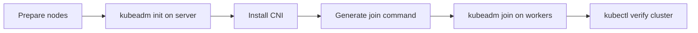
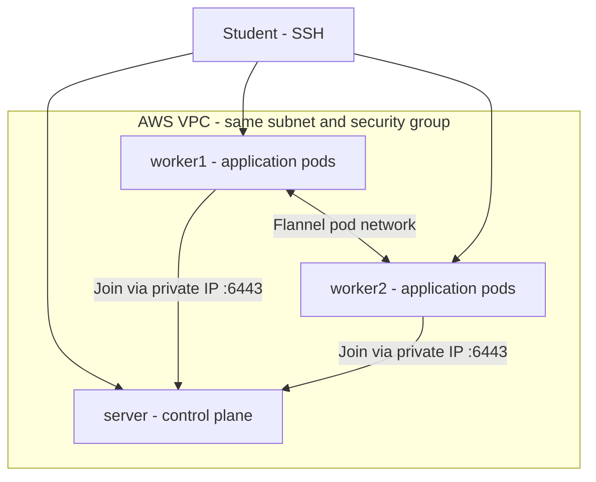

# Kubernetes kubeadm Cluster on AWS EC2 — Amazon Linux 2023

Hands-on lab: build a **three-node, self-managed Kubernetes cluster** with **1 control-plane server + 2 workers** using **kubeadm**, **containerd**, and **Flannel**.

> This is a disposable training lab, not a production high-availability architecture. Follow the sections in order. Commands marked **ALL NODES** run independently on all three EC2 instances; **SERVER ONLY** and **WORKERS ONLY** are role-specific.

## Contents

- [Technology stack](#technology-stack)
- [Kubernetes basics](#kubernetes-basics)
- [Why kubeadm?](#why-kubeadm)
- [Repository layout](#repository-layout)
- [Architecture](#architecture)
- [Version compatibility](#version-compatibility-reviewed-24-november-2026)
- [Steps 1–6: Infrastructure and node preparation](#1-create-ec2-instances--aws-console)
- [Steps 7–11: Cluster initialization and verification](#7-initialize-cluster--server-only)
- [Step 12: Deploy and test applications](#12-deploy-and-test-applications--server-only)
- [Troubleshooting](#13-troubleshooting)
- [Cleanup](#14-cleanup-and-costs)
- [Worked AWS example](#worked-example--aws-ec2-lab-24-november-2026)
- [Optional automation](#optional-automation)
- [Command validation](#command-validation)
- [References](#references)

## Lab objectives

By the end of this lab, you should be able to:

- Create and connect to three EC2 instances.
- Install a compatible container runtime and Kubernetes tools.
- Initialize a control plane and join two workers.
- Verify cluster health and deploy, test and remove an application.

> **Reading guide:** Run each numbered step in order. Commands use monospace formatting; replace placeholders with your own values. Keep separate SSH terminals for each node.

## Technology stack

| Layer | Technology | What it does |
|---|---|---|
| Cloud | AWS EC2 | Provides three virtual machines |
| Network | VPC, subnet, security group | Connects and protects the nodes |
| Storage | EBS | Stores OS and application files |
| OS | Amazon Linux 2023 | Linux environment for Kubernetes |
| Runtime | containerd 2.3/2.4 | Runs containers |
| Orchestration | Kubernetes v1.37 | Manages containerized applications |
| Setup | kubeadm | Creates the cluster and joins workers |
| Node agent | kubelet | Keeps pods running on each node |
| CLI | kubectl | Sends commands to the Kubernetes API |
| Pod network | Flannel CNI | Connects pods across nodes |
| Test application | Nginx | Verifies application deployment |
| Automation | Bash, YAML | Automates setup and defines resources |

## Kubernetes basics

**Kubernetes (K8s)** is an open-source container orchestration platform. It deploys, scales, networks and manages containerized applications.

**Why Kubernetes?** It supports automatic recovery, scaling, service discovery, load balancing and rolling updates.

| Concept | Simple definition |
|---|---|
| Container | Isolated running application with its dependencies |
| Image | Packaged template used to create containers |
| Cluster | Group of machines managed by Kubernetes |
| Node | Physical or virtual machine in a cluster |
| Control plane | Manages cluster state and scheduling |
| Worker node | Runs application workloads |
| Pod | Smallest deployable unit; contains one or more containers |
| ReplicaSet | Maintains a desired number of matching pods |
| Deployment | Manages ReplicaSets and application updates |
| Service | Stable network endpoint for a group of pods |
| Namespace | Logical grouping of Kubernetes resources |
| DaemonSet | Runs a pod on every eligible node |
| ConfigMap | Stores non-secret configuration |
| Secret | Stores sensitive configuration; requires appropriate access and encryption controls |
| PersistentVolume | Storage resource independent of a pod |
| PersistentVolumeClaim | Request for persistent storage |
| Ingress | HTTP/HTTPS routing rules; requires an Ingress controller |
| HPA | Automatically adjusts workload replica count using metrics |
| CNI | Interface for pod networking plugins |
| CRI | Interface between kubelet and container runtime |

## Why kubeadm?

**kubeadm** is an official Kubernetes bootstrapping tool that initializes a control plane and joins nodes to a cluster. It is not a container runtime or a cloud infrastructure provisioning tool.

- Learn how a real multi-node Kubernetes cluster works.
- Understand certificates, tokens, networking and control-plane components.
- Build a self-managed cluster on EC2, virtual machines or bare metal.
- Practice installation, administration and troubleshooting without a managed control plane.

| Tool | Best use |
|---|---|
| kubeadm | Self-managed multi-node clusters and administration practice |
| Minikube | Local learning and development |
| Amazon EKS | AWS-managed Kubernetes control plane |

kubeadm requires you to manage infrastructure, runtime, networking, upgrades, backups and security. This lab has one control plane and is not highly available.

### How kubeadm works



See [technology stack and component roles](docs/technology-stack.md) and [platform comparison](difference.md).

## Repository layout

- [steps.md](steps.md) — quick checklist
- [docs/architecture.md](docs/architecture.md) — architecture and flow diagrams
- [docs/runtime.md](docs/runtime.md) — containerd compatibility and fallback
- [docs/technology-stack.md](docs/technology-stack.md) — component definitions and command reference
- [docs/automation.md](docs/automation.md) — optional script-based setup
- [scripts/](scripts/) — node preparation, runtime, Kubernetes installation, initialization and verification
- [manifests/](manifests/) — Deployment, Service and DaemonSet exercises
- [difference.md](difference.md) — kubeadm vs EKS vs Minikube

## Architecture



| Node | Instance | Disk | Role |
|---|---|---|---|
| server | t3.large | 70 GiB | Manage cluster |
| worker1 | t3.medium | 50 GiB | Run applications |
| worker2 | t3.medium | 50 GiB | Run applications |

All nodes run Amazon Linux 2023, containerd and kubelet. Flannel connects pods using CIDR `10.244.0.0/16`.

[View component, installation and application diagrams](docs/architecture.md).

## Version compatibility (reviewed 24 November 2026)

- Kubernetes stable minor channel: **v1.37**; the supplied live lab output reports v1.37.2. Install the newest available patch from this channel on all nodes.
- Containerd: **2.3.x or 2.4.x**; AWS AL2023 release 2023.12.20261117 provides containerd 2.3.7; see [upstream compatibility matrix](https://github.com/containerd/containerd/blob/main/RELEASES.md#kubernetes-support).
- Flannel: latest stable manifest from its official release page.
- Amazon Linux 2023: use the latest available AMI and review [AL2023 updates](https://docs.aws.amazon.com/linux/al2023/ug/managing-repos-os-updates.html).

If the Amazon Linux package repository does not supply a compatible containerd version, **stop before kubeadm init**. Install a compatible runtime following the [upstream installation guide](https://github.com/containerd/containerd/blob/main/docs/getting-started.md) (including runc, systemd service and CNI dependencies), or choose an OS/runtime combination supported by the matrix. Do not assume the distribution package is the latest upstream release.

## 1. Create EC2 instances — AWS Console

| Setting | server | worker1 | worker2 |
|---|---|---|---|
| AMI | Amazon Linux 2023, x86_64 | Same | Same |
| Instance | t3.large (2 vCPU / 8 GiB) | t3.medium (2 vCPU / 4 GiB) | t3.medium |
| Root EBS (gp3) | 70 GiB | 50 GiB | 50 GiB |
| Key pair | `kubeadm` (RSA, .pem download) | Same key | Same key |
| VPC / subnet | Same VPC and subnet | Same | Same |
| Security group | Dedicated cluster SG | Same | Same |

### AWS Console settings

Open EC2 > Instances > Launch instances. Select the Amazon Linux 2023 x86_64 AMI, instance type and key pair from the table. Create the key pair once and reuse it. Keep the PEM file locally.

For this direct SSH lab, select a public subnet with a route to an Internet Gateway and enable Auto-assign public IP. Use private IPv4 for node-to-node traffic. In Network settings choose the same dedicated security group for all three nodes.

| Direction | Type | Source / destination |
|---|---|---|
| Inbound | SSH TCP 22 | My IP (/32) |
| Inbound | All traffic | Same security group ID |
| Outbound | All traffic | 0.0.0.0/0 (lab downloads) |

The self-reference permits traffic using private IPs, not public IPs. Do not expose the API or all traffic to the internet.

- Give each instance a different **Name**. A single subnet is easiest for this lab, but not a Kubernetes requirement.
- Nodes must reach package repositories and image registries (Internet Gateway/NAT as appropriate).
- Select a subnet/VPC CIDR **that does not overlap** the Flannel Pod CIDR `10.244.0.0/16`. Also avoid overlap with the default Service CIDR `10.96.0.0/12`. Default AWS VPC `172.31.0.0/16` is fine.
- Set the security group's **inbound SSH TCP 22** source to **your own public IP (/32)**, not everyone.
- Add an inbound rule **All traffic / All protocols**, with **source = the cluster security group itself** (self-reference). This permits trusted node-to-node networking including API server TCP 6443 and Flannel VXLAN UDP 8472. **Never use 0.0.0.0/0 for All traffic.**
- Keep normal outbound access for package downloads and container image pulls. Do not open 6443 publicly.

### Record your instance addresses

```text
SERVER_PUBLIC_IP=...
SERVER_PRIVATE_IP=...
WORKER1_PUBLIC_IP=...
WORKER1_PRIVATE_IP=...
WORKER2_PUBLIC_IP=...
WORKER2_PRIVATE_IP=...
```

## 2. Connect — each EC2 instance

From your Mac/Linux terminal (or use EC2 Instance Connect):

```bash
chmod 400 kubeadm.pem
ssh -i kubeadm.pem ec2-user@SERVER_PUBLIC_IP
# Open a SECOND terminal:
ssh -i kubeadm.pem ec2-user@WORKER1_PUBLIC_IP
# Open a THIRD terminal:
ssh -i kubeadm.pem ec2-user@WORKER2_PUBLIC_IP
```

Replace the uppercase IP placeholders with actual addresses; do not paste all three SSH commands into one EC2 session.

## 3. Set hostnames — ALL NODES (different command on each)

**On server**:

```bash
sudo hostnamectl set-hostname server
```

**On worker1**:

```bash
sudo hostnamectl set-hostname worker1
```

**On worker2**:

```bash
sudo hostnamectl set-hostname worker2
```

Verify on each: `hostnamectl --static`. Ensure each hostname resolves to the correct *private* IP through your network's DNS or by adding unique entries in `/etc/hosts` on **all three** nodes. Example (replace values):

```bash
sudo tee -a /etc/hosts <<'EOF'
<SERVER_PRIVATE_IP> server
<WORKER1_PRIVATE_IP> worker1
<WORKER2_PRIVATE_IP> worker2
EOF
```

## 4. OS and kernel preparation — ALL NODES

```bash
# For an older AL2023 release only, upgrade to the verified baseline:
# sudo dnf upgrade --releasever=2023.12.20261117 -y
sudo dnf upgrade -y
sudo dnf install -y curl tar conntrack-tools socat iproute-tc iptables
getenforce
uname -r
# A reboot may be needed if the kernel was updated; reconnect afterward.
sudo swapoff -a
sudo sed -i.bak '/[[:space:]]swap[[:space:]]/s/^/#/' /etc/fstab

sudo tee /etc/modules-load.d/k8s.conf <<'EOF'
overlay
br_netfilter
EOF
sudo modprobe overlay
sudo modprobe br_netfilter

sudo tee /etc/sysctl.d/k8s.conf <<'EOF'
net.bridge.bridge-nf-call-iptables = 1
net.bridge.bridge-nf-call-ip6tables = 1
net.ipv4.ip_forward = 1
EOF
sudo sysctl --system
swapon --show
sysctl net.ipv4.ip_forward
```

`swapon --show` should print nothing; IP forwarding should be `1`.

## 5. Install containerd — ALL NODES

```bash
sudo dnf install -y containerd
rpm -q containerd
containerd --version
# Review the printed version against the compatibility matrix above.
# Continue only with a compatible 2.3.x or 2.4.x runtime.
sudo mkdir -p /etc/containerd
sudo test ! -f /etc/containerd/config.toml || sudo cp -n /etc/containerd/config.toml /etc/containerd/config.toml.pre-kubeadm
containerd config default | sudo tee /etc/containerd/config.toml >/dev/null
# Change the runtime cgroup driver (works with default 1.x/2.x generated configs)
sudo sed -i 's/SystemdCgroup = false/SystemdCgroup = true/g' /etc/containerd/config.toml
grep -n 'SystemdCgroup\|disabled_plugins' /etc/containerd/config.toml
sudo systemctl enable --now containerd
sudo systemctl restart containerd
sudo systemctl is-active containerd
```

Expected: `SystemdCgroup = true`, with the CRI plugin **not disabled**, and the service `active`. Containerd 1.x and 2.x configuration sections differ; consult the [official container runtime guide](https://kubernetes.io/docs/setup/production-environment/container-runtimes/) if `containerd`/CRI checks fail. Do not disable SELinux globally as a troubleshooting shortcut.

## 6. Install kubeadm, kubelet, kubectl — ALL NODES

This lab uses the Kubernetes **v1.37** RPM channel consistently across nodes. Choose another supported *minor* version only by changing the URL on **all three nodes** before installation.

```bash
sudo tee /etc/yum.repos.d/kubernetes.repo <<'EOF'
[kubernetes]
name=Kubernetes
baseurl=https://pkgs.k8s.io/core:/stable:/v1.37/rpm/
enabled=1
gpgcheck=1
gpgkey=https://pkgs.k8s.io/core:/stable:/v1.37/rpm/repodata/repomd.xml.key
exclude=kubelet kubeadm kubectl cri-tools kubernetes-cni
EOF

sudo dnf install -y kubelet kubeadm kubectl cri-tools kubernetes-cni --disableexcludes=kubernetes
sudo systemctl enable --now kubelet

```

Check SELinux with `getenforce`. Upstream RPM instructions use permissive mode; on a disposable lab only, if enforcing and required by the CNI, use `sudo setenforce 0` and set `SELINUX=permissive` in `/etc/selinux/config`. Prefer a supported enforcing configuration for production.

The kubelet may repeatedly restart until the node has been initialized/joined. That is expected. Do not run `kubeadm init` on workers.

### Verify installed versions — ALL NODES

Run these commands on the server and both workers before initializing the cluster. Confirm matching Kubernetes versions and a compatible container runtime.

```bash
cat /etc/os-release
containerd --version
kubeadm version
kubelet --version
kubectl version --client
rpm -q kubeadm kubelet kubectl
sudo crictl --runtime-endpoint unix:///run/containerd/containerd.sock info
for plugin in bridge loopback host-local portmap; do
  test -x "/opt/cni/bin/$plugin" || echo "Missing CNI plugin: $plugin"
done
```

Stop if any plugin is missing or CRI verification fails.

If containerd was installed from RPM, also run `rpm -q containerd`. An upstream binary installation will not have an RPM record.

## 7. Initialize cluster — SERVER ONLY

Check that `hostname -I` contains the server's correct VPC **private** IPv4 address. Set it explicitly:

```bash
SERVER_PRIVATE_IP="REPLACE_WITH_SERVER_PRIVATE_IP"
sudo kubeadm init \
  --kubernetes-version="$(kubeadm version -o short)" \
  --apiserver-advertise-address="$SERVER_PRIVATE_IP" \
  --pod-network-cidr=10.244.0.0/16 \
  --cri-socket=unix:///run/containerd/containerd.sock
```

After `Your Kubernetes control-plane has initialized successfully!`, configure the current user:

```bash
mkdir -p "$HOME/.kube"
sudo install -o "$(id -u)" -g "$(id -g)" -m 600 /etc/kubernetes/admin.conf "$HOME/.kube/config"
kubectl cluster-info
kubectl get nodes
```

The control plane is often `NotReady` until a Pod CNI is installed.

## 8. Install Flannel Pod networking — SERVER ONLY

Use **only one CNI**. The Pod CIDR used in `kubeadm init` above matches Flannel defaults.

```bash
kubectl apply -f https://github.com/flannel-io/flannel/releases/latest/download/kube-flannel.yml
kubectl get pods -n kube-flannel
kubectl get pods -n kube-system
```

For repeatable long-lived environments, pin a tested Flannel release rather than using `latest`. Do **not** add Calico after Flannel in this lab.

## 9. Generate worker join command — SERVER ONLY

```bash
sudo kubeadm token create --print-join-command
```

Example output (**example placeholders, not valid credentials**):

```bash
kubeadm join <SERVER_PRIVATE_IP>:6443 \
  --token <GENERATED_TOKEN> \
  --discovery-token-ca-cert-hash sha256:<GENERATED_HASH> \
  --cri-socket=unix:///run/containerd/containerd.sock
```

Copy the **actual freshly generated** command from your server terminal. Token values expire; never commit active tokens to a public repository.

## 10. Join the cluster — WORKER1 and WORKER2 ONLY

On **each worker's own terminal**, paste the command from step 9, prefixing it with `sudo` and appending `--cri-socket=unix:///run/containerd/containerd.sock` if not already present:

```bash
sudo kubeadm join <SERVER_PRIVATE_IP>:6443 \
  --token <GENERATED_TOKEN> \
  --discovery-token-ca-cert-hash sha256:<GENERATED_HASH>
```

Do not execute this sample literally. Use the real server IP/token/hash. Each worker should report successful joining. Workers do **not** need the server's `admin.conf`.

## 11. Verify — SERVER ONLY

```bash
kubectl wait --for=condition=Ready node/server node/worker1 node/worker2 --timeout=300s
kubectl get nodes -o wide
kubectl get pods -n kube-system
kubectl get pods -n kube-flannel
kubectl rollout status daemonset/kube-flannel-ds -n kube-flannel --timeout=300s
kubectl rollout status deployment/coredns -n kube-system --timeout=300s
kubectl get pods -A -o wide
```

Expected eventually:

```text
NAME      STATUS   ROLES           AGE   VERSION
server    Ready    control-plane   ...   v1.37.x
worker1   Ready    <none>          ...   v1.37.x
worker2   Ready    <none>          ...   v1.37.x
```

Check `kubectl get nodes -o wide` to confirm each node has a **different private IP**.

## 12. Deploy and test applications — SERVER ONLY


Port-forward selects a backing pod through the Service; it does not expose the application publicly.

Use the provided YAML files for all application exercises. Do not create a second Deployment with the same name using imperative commands.

```bash
sudo dnf install -y git
git clone https://github.com/atulkamble/ec2-kubeadm.git
cd ec2-kubeadm
```

If already cloned, simply enter the existing repository directory.

| File | Purpose |
|---|---|
| manifests/deployment.yaml | Two Nginx replicas |
| manifests/service.yaml | Internal ClusterIP endpoint |
| manifests/daemonset.yaml | One Nginx pod per eligible node |

### 12.1 Deploy

```bash
kubectl apply --dry-run=server -f manifests/
kubectl apply -f manifests/
kubectl rollout status deployment/nginx --timeout=180s
kubectl rollout status daemonset/nginx-per-node --timeout=180s
kubectl get deployments,daemonsets,services
kubectl get pods -o wide
```

### 12.2 Test HTTP access

```bash
kubectl port-forward svc/nginx 8080:80
```

Open another SSH session to the server and run:

```bash
curl -I http://127.0.0.1:8080
```

Expected: HTTP 200. Stop port-forward with Ctrl+C in the original terminal. Deployment replicas may share a worker; the DaemonSet should run on both eligible workers.

## 13. Troubleshooting

| Symptom | Check |
|---|---|
| `kubeadm init` preflight error | `swapon --show`, containerd active, correct VPC private IP, sufficient resources |
| `kubeadm join` times out | Self-referencing cluster SG, TCP 6443 reachability, server API health |
| `container runtime is not running` | `sudo systemctl status containerd`; CRI plugin and cgroup settings |
| `NotReady` nodes | Flannel pods, `kubectl describe node <node>`, kernel modules and forwarding |
| `ContainerCreating` stuck | `kubectl describe pod <pod>`, `kubectl get pods -A`, CNI logs |
| Worker token expired | Run `sudo kubeadm token create --print-join-command` on server again |

Useful diagnostics:

```bash
# SERVER:
kubectl get nodes -o wide
kubectl get pods -A -o wide
kubectl describe node worker1

# AFFECTED NODE:
sudo systemctl status containerd --no-pager
sudo systemctl status kubelet --no-pager
sudo journalctl -u kubelet -n 100 --no-pager
```

Avoid resetting the cluster or rerunning `kubeadm init` until you've identified the error.

## 14. Cleanup and costs

Stop any active port-forward session before cleanup. Run the following from the cloned repository directory on the server.

```bash
# SERVER, if the example still exists:
kubectl delete -f manifests/ --ignore-not-found
```

To end the lab, terminate the EC2 instances and remove unused EBS volumes, public IPv4 allocations, and related paid resources as appropriate. Review the [official kubeadm teardown instructions](https://kubernetes.io/docs/setup/production-environment/tools/kubeadm/create-cluster-kubeadm/#tear-down) before reusing nodes. EC2, EBS, and public IPv4 can generate charges.

## Worked example — AWS EC2 lab (24 November 2026)

The following values are from a completed training lab. Public IPs are historical examples; use your own current instance addresses. Never reuse or publish bootstrap tokens.

| Setting | Example |
|---|---|
| Operating system | Amazon Linux 2023 |
| Root storage | 70 GiB SSD (gp3 recommended) |
| Key pair | kubeadm |
| Private key | `kubeadm.pem` |
| VPC | Default VPC |
| Security group | Default security group (lab example only) |
| Node communication | All traffic, source = same security group ID |

A dedicated security group is recommended for new labs. If using the default security group, confirm its self-referencing inbound rule and add SSH TCP 22 from your own public IP (/32). Do not allow all traffic from the internet. Avoid changing a shared security group used by unrelated instances.

### Example instance addresses

| Node | Public IPv4 (SSH) | Private IPv4 (cluster) |
|---|---|---|
| server | `3.80.214.107` | `172.31.29.239` |
| worker1 | `100.53.137.103` | `172.31.30.104` |
| worker2 | `3.94.193.250` | `172.31.29.113` |

### Example SSH commands — local terminal

```bash
chmod 400 kubeadm.pem
ssh -i kubeadm.pem ec2-user@3.80.214.107
# Separate terminals:
ssh -i kubeadm.pem ec2-user@100.53.137.103
ssh -i kubeadm.pem ec2-user@3.94.193.250
```

### Example hostname resolution — ALL NODES

Run once on each node after setting its hostname.

```bash
sudo tee -a /etc/hosts <<'EOF'
172.31.29.239 server
172.31.30.104 worker1
172.31.29.113 worker2
EOF
```

### Example initialization — SERVER ONLY

After completing prerequisites and package installation:

```bash
SERVER_PRIVATE_IP="172.31.29.239"
sudo kubeadm init \
  --kubernetes-version="$(kubeadm version -o short)" \
  --apiserver-advertise-address="$SERVER_PRIVATE_IP" \
  --pod-network-cidr=10.244.0.0/16 \
  --cri-socket=unix:///run/containerd/containerd.sock
```

Complete kubeconfig and Flannel configuration in steps 7–8 before joining workers.

### Example worker join — WORKERS ONLY

Generate a fresh command on the server:

```bash
sudo kubeadm token create --print-join-command
```

Example format (credentials redacted; do not run literally):

```bash
sudo kubeadm join 172.31.29.239:6443 \
  --token REDACTED_TOKEN \
  --discovery-token-ca-cert-hash sha256:REDACTED_HASH \
  --cri-socket=unix:///run/containerd/containerd.sock
```

Use the actual generated command on both workers. Revoke any bootstrap token that has been shared.

### Observed cluster output — SERVER ONLY

The following output was supplied from the live lab:

```text
[ec2-user@ip-172-31-29-239 ~]$ kubectl get nodes
NAME      STATUS   ROLES           AGE    VERSION
server    Ready    control-plane   114s   v1.37.2
worker1   Ready    <none>          14s    v1.37.2
worker2   Ready    <none>          8s     v1.37.2
```

**Result:** All three nodes reported Ready with Kubernetes v1.37.2. This confirms node readiness in the supplied lab output, not application or full script testing.

## Optional automation

Use this alternative on fresh EC2 instances instead of manual steps 3–11. Complete steps 1–2 first.

### A. Clone the repository — ALL NODES

```bash
sudo dnf install -y git
git clone https://github.com/atulkamble/ec2-kubeadm.git
cd ec2-kubeadm
```

### B. Prepare each node

Run only the command matching the node:

```bash
sudo bash scripts/01-prepare-node.sh server
# On worker1 instead:
# sudo bash scripts/01-prepare-node.sh worker1
# On worker2 instead:
# sudo bash scripts/01-prepare-node.sh worker2
```

Complete hostname resolution as in step 3. Reboot and reconnect if required.

### C. Install runtime and Kubernetes — ALL NODES

```bash
sudo bash scripts/02-install-runtime.sh
sudo bash scripts/03-install-kubernetes.sh
rpm -q kubeadm kubelet kubectl
```

Stop on any error. Compare versions across all three nodes. Review the SELinux guidance in step 6 before initialization.

### D. Initialize — SERVER ONLY

```bash
bash scripts/04-init-server.sh REPLACE_WITH_SERVER_PRIVATE_IP
```

Replace the placeholder with the actual private IPv4 address. Copy the printed join command, including sudo and the CRI socket, and execute it on each worker.

### E. Verify — SERVER ONLY

```bash
bash scripts/05-verify-cluster.sh
```

When all nodes and system workloads are ready, continue with step 12 (skip cloning again).

## Command validation

| Check | Expected result |
|---|---|
| Swap | No active swap |
| IP forwarding | 1 |
| Containerd | active; CRI responds |
| Kubernetes packages | Matching versions on all three nodes |
| Nodes | Three Ready nodes |
| Flannel and CoreDNS | Successful rollout |
| Application | Successful rollout and HTTP 200 |

Commands statically reviewed for consistency with the scripts and linked Kubernetes documentation. The supplied live EC2 output confirms three Ready nodes; full script and application execution have not been independently verified. Use fresh lab instances and stop on failed prerequisite checks.

## References

- [AWS AL2023 release 2023.12.20261117](https://docs.aws.amazon.com/linux/al2023/release-notes/relnotes-2023.12.20261117.html)
- [EC2 launch parameters](https://docs.aws.amazon.com/AWSEC2/latest/UserGuide/ec2-instance-launch-parameters.html)
- [AWS security group rules](https://docs.aws.amazon.com/AWSEC2/latest/UserGuide/security-group-rules-reference.html)
- [AWS SSH troubleshooting](https://docs.aws.amazon.com/AWSEC2/latest/UserGuide/TroubleshootingInstancesConnecting.html)

- [Kubernetes kubeadm installation](https://kubernetes.io/docs/setup/production-environment/tools/kubeadm/install-kubeadm/)
- [Kubernetes container runtimes](https://kubernetes.io/docs/setup/production-environment/container-runtimes/)
- [Kubernetes required ports](https://kubernetes.io/docs/reference/networking/ports-and-protocols/)
