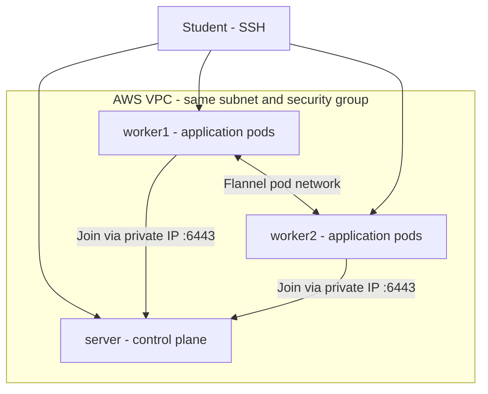
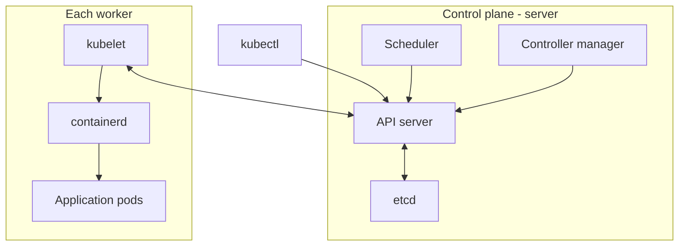
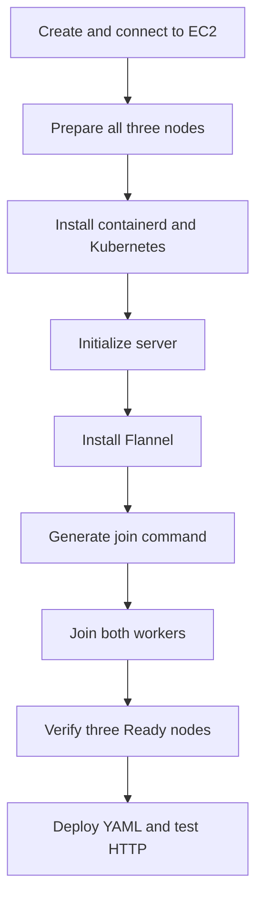
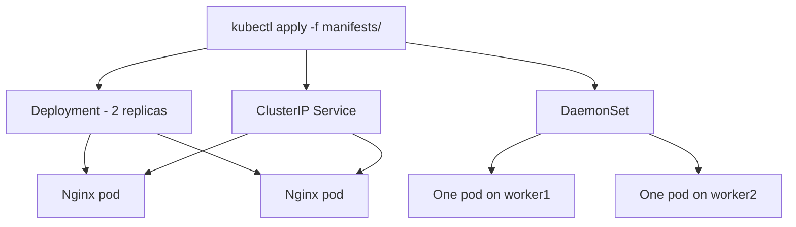

# Architecture diagrams

## 1. EC2 cluster

## 2. Kubernetes components

The API server receives requests, etcd stores state, the scheduler selects nodes, and kubelet asks containerd to run containers.

## 3. Installation flow

## 4. Application testing

Deployment pods may run on either worker. The Service selects Deployment pods, not DaemonSet pods. The control plane is normally tainted to prevent ordinary workloads from scheduling there.

Follow [README.md](../README.md) for the complete practical. This single-control-plane cluster is for training, not high availability.
