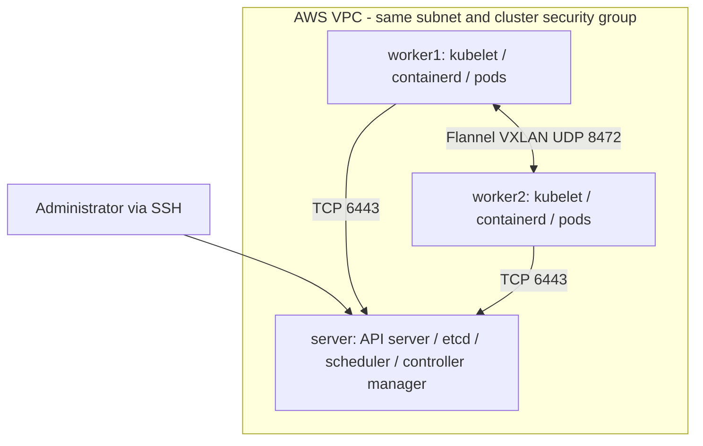
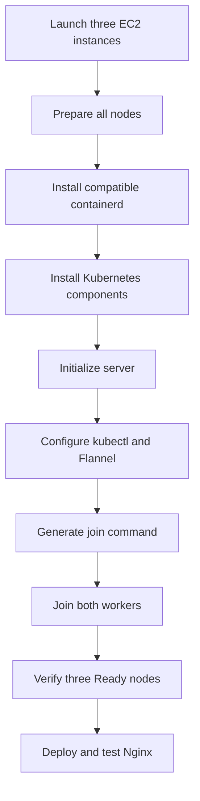

# Architecture and execution flow

The cluster is self-managed and has a single control-plane failure point. The default control-plane taint prevents ordinary workloads from scheduling there. This is a lab, not an HA production design.
