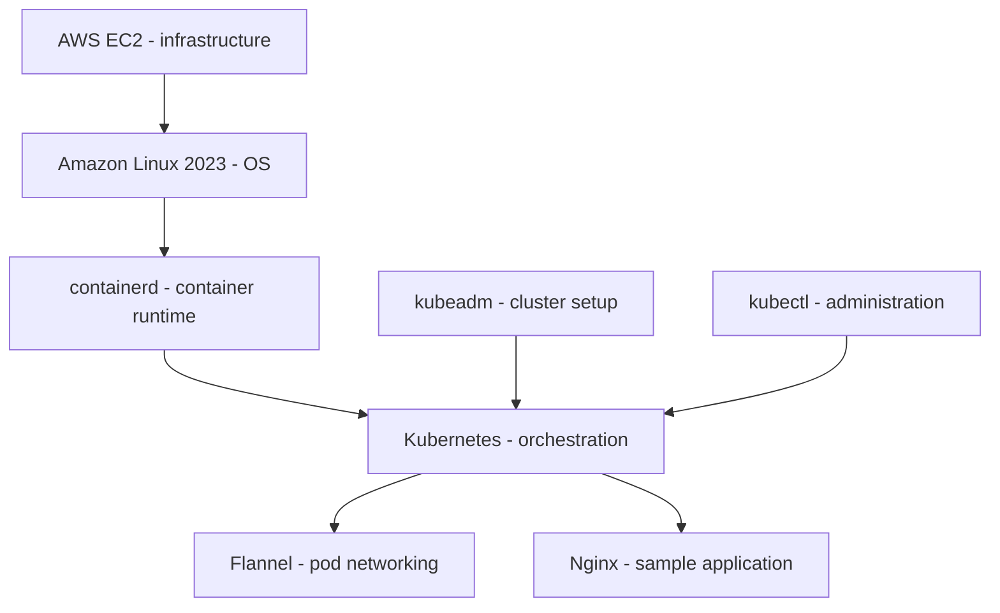

# Technology stack and definitions

## Stack chart

## Kubernetes components

| Component | Runs on | Purpose |
|---|---|---|
| kube-apiserver | Server | Receives API requests |
| etcd | Server | Stores cluster state |
| kube-scheduler | Server | Selects a node for each new pod |
| kube-controller-manager | Server | Reconciles desired and actual state |
| kubelet | All nodes | Manages pods assigned to its node |
| kube-proxy | All nodes by default | Implements Service networking |
| containerd | All nodes | Runs containers |
| Flannel | All nodes | Provides pod networking |
| CoreDNS | Cluster pods | Resolves Kubernetes DNS names |
| kubeadm | All nodes | Bootstraps and joins nodes |
| kubectl | Administrator / server | Manages Kubernetes via API |

## Commands and meanings

| Command | Meaning |
|---|---|
| `kubeadm init` | Initialize control plane |
| `kubeadm token create --print-join-command` | Generate worker join command |
| `kubeadm join` | Join a node to the cluster |
| `kubectl get nodes -o wide` | List nodes and network details |
| `kubectl get pods -n kube-system` | Inspect system pods |
| `kubectl apply -f manifests/` | Create or update resources from YAML |
| `kubectl describe pod NAME` | Inspect pod details and events |
| `kubectl logs POD_NAME` | Read container logs |

## Networking terms

| Term | Definition |
|---|---|
| VPC | Private virtual network in AWS |
| Subnet | Address range inside a VPC |
| Security group | Stateful network firewall for EC2 |
| Private IP | Address used for communication within the VPC |
| Public IP | Internet-routable address, used for restricted SSH in this lab |
| Pod CIDR | Address range for pods; must not overlap node network |
| ClusterIP | Internal virtual IP for a Kubernetes Service |
| CNI | Standard interface for container networking plugins |
| VXLAN | Overlay networking used by default by Flannel |

See [README](../README.md) for version requirements and setup, and [architecture](architecture.md) for the cluster diagram.

## AWS lab baseline

Amazon Linux 2023 x86_64 release 2023.12.20261117 includes containerd 2.3.7. Use the same VPC, public subnet and dedicated self-referencing security group. SSH uses ec2-user and the local kubeadm.pem key; Kubernetes uses private IPs.

[Official AWS release notes](https://docs.aws.amazon.com/linux/al2023/release-notes/relnotes-2023.12.20261117.html)
